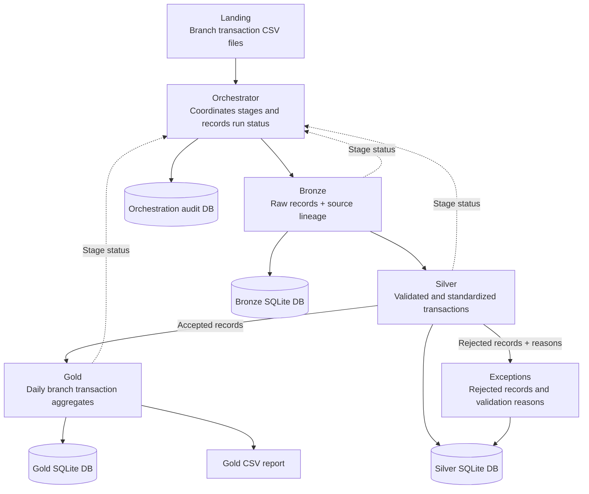

## Overview

This project implements an end-to-end banking transaction data pipeline using Python, SQLite and PySpark. It ingests branch transaction CSV files, validates and standardizes records, captures rejected records, and publishes daily branch-level transaction aggregates.

The pipeline follows a layered architecture:

**Landing → Bronze → Silver → Gold**

Rejected records are recorded in an Exceptions table, while the orchestrator coordinates execution and records pipeline status and failures.

## Architecture and Data Flow

The Banking Data Pipeline follows a layered architecture that processes branch transaction CSV files from ingestion to reporting. An orchestrator coordinates the pipeline stages, while audit records track execution status and failures.

### Architecture Diagram



### How to Interpret the Diagram

1. **Landing — Input Files**  
   Branch transaction CSV files are placed in the landing directory. The pipeline identifies supported filenames and processes the files for ingestion.

2. **Orchestrator — Pipeline Coordination**  
   The orchestrator executes the Bronze, Silver and Gold stages in sequence. It tracks stage statuses, records run information and captures failures so that downstream stages are not executed when an earlier stage fails.

3. **Bronze — Raw Data Ingestion**  
   Raw transaction records are loaded into the Bronze SQLite database. Source lineage, including filename, branch identifier, file date, source row number, load timestamp and run identifier, supports traceability.

4. **Silver — Validation and Standardization**  
   Bronze records are checked for data-quality issues and standardized. Accepted transactions are stored in the Silver SQLite database. The pipeline also handles duplicate transaction IDs and corrections according to its processing rules.

5. **Exceptions — Rejected Records**  
   Records that fail validation are recorded with their rejection reasons, such as an unknown account, invalid amount or invalid transaction date. This allows data-quality issues to be investigated without including rejected records in Gold aggregates.

6. **Gold — Aggregated Business Data**  
   Accepted Silver transactions are aggregated by branch identifier, transaction date and transaction type. The resulting transaction count and total amount are stored in the Gold SQLite database and published as a CSV report.

7. **Audit Databases — Execution History**  
   The Bronze, Silver and Gold databases maintain their respective processing and audit records. The orchestration audit database records the overall pipeline status, stage statuses, run information and failure details.

### End-to-End Flow

The normal processing flow is:

**Landing → Orchestrator → Bronze → Silver → Gold → Gold CSV report**

Silver also routes rejected records to **Exceptions**. Stage statuses and execution outcomes are reported to the orchestrator for auditability and failure handling.

The pipeline is designed to support validation, traceability, correction handling, rerun safety and recovery after a failed run without unnecessarily deleting previously published Gold results.


### Key Features

- CSV ingestion with file identification and duplicate-file detection.
- Bronze storage with raw records and source lineage.
- Silver validation, standardization, duplicate detection and correction handling.
- Exception tracking with rejection reasons.
- Gold aggregation using PySpark.
- SQLite storage for auditable processing results.
- Orchestration audit records for pipeline runs and stage statuses.
- Rerun-safety and operational recovery testing.
- Automated regression tests using pytest.


## Technology Stack

| Technology | Purpose |
|---|---|
| Python | Pipeline implementation and orchestration |
| SQLite | Bronze, Silver, Gold and audit storage |
| PySpark | Distributed-data processing API and Gold aggregation |
| SQL | Validation queries, aggregation checks and data verification |
| pytest | Automated regression testing |
| CSV | Input and published Gold report format |
| PowerShell | Local development and execution on Windows |

The current implementation uses PySpark in local mode for development and testing. SQLite provides persistent, inspectable storage without requiring a separate database server.

## Project Structure

The main project components are organized as follows:

```text
banking_data_pipeline/
|
├
├── capstone/
│   ├── landing/
│   ├── input/
│   ├── database/
│   ├── output/
│   │   └── gold/
│   ├── src/
│   ├── orchestration/
│   ├── tests/
│   ├── test/
│   └── docs/
|   |── requirements-capstone.txt
|   |── README.md
└
```

- `landing/`: Normal pipeline input files.
- `input/`: Supporting reference data, including `account_reference.csv`.
- `database/`: Normal pipeline SQLite databases and schemas.
- `output/gold/`: Published Gold CSV report.
- `src/`: Bronze ingestion, Silver processing, Gold aggregation and database initialization modules.
- `orchestration/`: Pipeline execution and stage coordination.
- `tests/`: Automated regression tests.
- `test/`: Isolated scenario inputs, databases, outputs and verification scripts.
- `docs/`: Supporting architecture and design documentation.

## Setup

### Prerequisites

- Python 3.13, matching the development environment used for this project.
- Java compatible with the installed PySpark version.
- PowerShell or another terminal.
- Git, if cloning the repository.

PySpark requires a compatible Java installation. Verify the installed versions before running the pipeline.

```powershell
python --version
java -version
```

### 1. Create and activate a virtual environment

From the repository root:

```powershell
python -m venv .venv
.\.venv\Scripts\Activate.ps1
```

If PowerShell blocks virtual-environment activation, use the appropriate execution-policy configuration for your environment or invoke the virtual environment's Python executable directly.

### 2. Install dependencies

Install the Capstone-specific dependencies:

```powershell
python -m pip install -r requirements-capstone.txt
```

The Capstone-specific dependency file should include the direct third-party dependencies required by the pipeline and tests, with versions matching the tested environment.

### 3. Verify the installation

```powershell
python -m pytest --version
python -c "import pyspark; print(pyspark.__version__)"
```

## Input Contract

### Branch transaction files

The pipeline expects CSV files following this filename pattern:

```text
BR001_20260906_TRANSACTION.csv
```

The filename identifies the branch and file date. Supported filenames follow the pattern:

```text
BRANCHID_YYYYMMDD_TRANSACTION.csv
```

For example:

```text
BR001_20260906_TRANSACTION.csv
BR002_20260906_TRANSACTION.csv
BR003_20260906_TRANSACTION.csv
```

Files that do not match the supported naming convention are skipped as unrecognized inputs.

### Required transaction columns

The CSV header must contain the following columns in the expected order:

| Column | Description |
|---|---|
| `transaction_id` | Unique transaction identifier |
| `account_id` | Account associated with the transaction |
| `transaction_date` | Date the transaction occurred |
| `transaction_type` | Transaction classification: `CREDIT` or `DEBIT` |
| `amount` | Positive transaction amount |
| `currency` | Transaction currency; currently `USD` |

Example:

```csv
transaction_id,account_id,transaction_date,transaction_type,amount,currency
T1001,A1001,2026-09-06,CREDIT,500.00,USD
T1002,A1002,2026-09-06,DEBIT,75.50,USD
```

### Account reference file

Place `account_reference.csv` in the pipeline's input directory.

Required columns:

| Column | Description |
|---|---|
| `account_id` | Account identifier used by transaction records |
| `branch_id` | Branch associated with the account |
| `account_status` | Account status used during validation |

Example:

```csv
account_id,branch_id,account_status
A1001,BR001,ACTIVE
A1002,BR001,ACTIVE
A2001,BR002,ACTIVE
```

### Validation rules

The Silver stage checks transaction records for data-quality issues, including:

- Required values and fields.
- Valid transaction dates.
- Numeric, positive transaction amounts.
- Supported transaction types.
- Supported currency.
- Account existence and account status.
- Consistency between the account's branch and the source branch.
- Duplicate transaction IDs within an incoming batch.

Rejected records are stored in Exceptions with the applicable rejection reasons. They are not included in Gold aggregates.

## Running the Pipeline

Run commands from the repository root with the virtual environment activated.

### Normal pipeline

```powershell
python .\capstone\orchestration\run_pipeline.py
```

The normal run uses the default Capstone directories under `capstone/`.

### Run an isolated scenario

The orchestrator supports scenario execution using the `--test` option:

```powershell
python .\capstone\orchestration\run_pipeline.py --test normal_input
```

Other supported scenarios include:

```powershell
python .\capstone\orchestration\run_pipeline.py --test invalid_records
python .\capstone\orchestration\run_pipeline.py --test duplicate_handling
python .\capstone\orchestration\run_pipeline.py --test late_arrival
python .\capstone\orchestration\run_pipeline.py --test failed_validation
python .\capstone\orchestration\run_pipeline.py --test rerun_safety
```

Each scenario uses its own landing directory, databases and output directory under `capstone/test/<scenario>/`. This isolates test execution from the normal Capstone data.

### Running tests

Run the complete automated regression suite:

```powershell
python -m pytest .\capstone\tests -v
```

Run a specific test file:

```powershell
python -m pytest .\capstone\tests\test_bronze_failure.py -v
python -m pytest .\capstone\tests\test_silver_failure.py -v
python -m pytest .\capstone\tests\test_gold_failure.py -v
python -m pytest .\capstone\tests\test_pipeline_recovery.py -v
```

These tests cover stage-failure handling, preservation of previously published Gold output and recovery after a corrected input is supplied.

### Verify normal-input results

The normal-input scenario includes a verification script:

```powershell
python .\capstone\test\normal_input\verify_normal_input.py
```

The script checks the expected Silver row count and Gold aggregation results for the normal-input test scenario.

## Output and Auditability

### Bronze

Bronze stores raw transaction records and lineage metadata, together with file-ingestion audit information and a registry for detecting unchanged files.

### Silver

Silver stores accepted standardized transactions. Rejected records and their reasons are recorded in `transaction_exceptions`. Corrections to existing transaction IDs are recorded in `silver_correction_audit`.

### Gold

Gold contains daily aggregates grouped by:

- `branch_id`
- `transaction_date`
- `transaction_type`

The principal measures are:

- `transaction_count`
- `total_amount`

The Gold SQLite table is `gold_branch_daily`. The published CSV is:

```text
capstone/output/gold/gold_branch_daily.csv
```

### Orchestration audit

The orchestration audit database records pipeline execution status, stage statuses, run identifiers and failure information. These records support investigation of unsuccessful runs.

## Assumptions and Design Decisions

1. **Transaction identifiers:** `transaction_id` is treated as globally unique. If the source system guarantees uniqueness only within a branch, the key should be changed to a composite key such as `(branch_id, transaction_id)`.

2. **Duplicate IDs within a batch:** If a transaction ID appears more than once in an incoming batch, all occurrences of that ID are rejected.

3. **Corrections:** If a transaction ID has already been accepted and appears again in a later batch, the later record is treated as a correction. The existing Silver record is updated and the change is recorded in `silver_correction_audit`.

4. **Currency:** Only `USD` is currently supported. Multi-currency conversion and exchange-rate handling are outside the current scope.

5. **Dates:** The file date is obtained from the filename, while `transaction_date` comes from the record. They serve different purposes and are not assumed to be identical.

6. **Unchanged files:** File hashes are used to detect unchanged input files and avoid ingesting them repeatedly.

7. **Gold aggregation:** Only accepted Silver transactions contribute to Gold totals.

8. **Failure handling:** If a stage fails, the orchestrator records the failure and prevents subsequent stages from running. A failed Gold build is tested to ensure previously published Gold results remain unchanged.

9. **Late arrivals:** Older business dates can be processed when their files arrive later. The current implementation uses transaction identifiers to identify corrections rather than a separate correction manifest.

10. **Execution environment:** The project is designed as a local Capstone implementation using CSV files, SQLite and PySpark local mode.

## Known Limitations

- The current pipeline uses local filesystem storage and SQLite, rather than cloud object storage or a production database service.
- PySpark runs locally; the project does not currently demonstrate deployment to a distributed Spark cluster.
- Only USD transactions are supported.
- There is no external scheduler or production monitoring service integrated into the current implementation.
- Transaction IDs are assumed to be globally unique.
- Corrections are identified by repeated transaction IDs, so the current policy does not distinguish a genuine correction from an identical replay of an existing transaction.
- The current setup uses a fixed input contract. Schema evolution and configurable column mappings are not implemented.


## Future Improvements

- Add a configurable schema contract and schema-evolution support.
- Extend automated reconciliation and PySpark-versus-SQL comparison tests.
- Add automated test reports and persisted scenario evidence.
- Integrate a scheduler and centralized monitoring.
- Explore cloud storage and a production-grade database for larger workloads.

## Conclusion

This Capstone demonstrates a layered transaction-processing pipeline with data-quality validation, lineage, exception handling, correction auditing, Gold aggregation, orchestration auditing, rerun safety and operational recovery. It provides a foundation for further development toward a production-grade data engineering workflow.