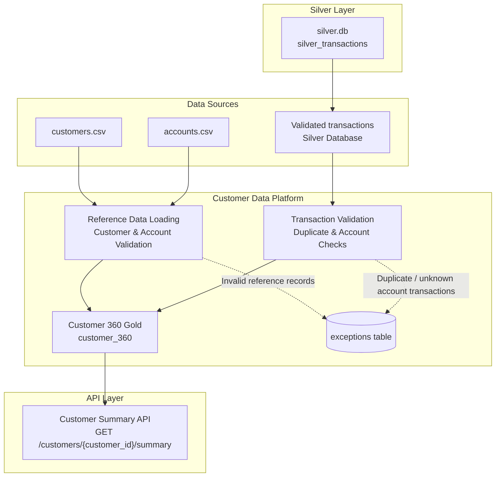

# Customer Data Platform (CDP) – Architecture

## Overview

The Customer Data Platform extends the Banking Data Pipeline by combining customer reference data, account information, and validated transaction data to produce a consolidated Customer 360 view.

## Architecture Diagram



## Component Description

### 1. Data Sources

The pipeline receives three inputs:

- `customers.csv` – customer IDs and customer names.
- `accounts.csv` – account IDs and their associated customer IDs.
- `silver_transactions` – validated banking transactions stored in `silver.db`.

### 2. Silver Layer

The existing banking pipeline stores validated transaction records in SQLite:

- Database: `silver.db`
- Table: `silver_transactions`

The CDP reads transaction data from this layer.

### 3. Customer Data Platform

The CDP combines customer, account, and transaction information.

**Reference Data Loading**
- Validates customer and account records.
- Rejects missing or duplicate identifiers.
- Checks whether account records reference existing customers.

**Transaction Validation**
- Rejects duplicate transaction IDs.
- Rejects transactions referencing unknown accounts.
- Records rejected records in the exceptions table.

**Customer 360 Gold**
- Combines customers, accounts, and valid transactions.
- Calculates account count, transaction count, total transaction amount, and last transaction date.
- Retains customers even when they have no transactions.

Output:
- Database: `cdp/database/cdp.db`
- Gold table: `customer_360`
- CSV snapshot: `cdp/output/customer_360.csv`

### 4. Exception Handling

Invalid records are not silently discarded.

The `exceptions` table stores:
- Entity type
- Entity ID
- Rejection reason

This provides evidence of rejected reference records and transactions.

### 5. API Layer

The Customer Summary API exposes the Customer 360 Gold data through an HTTP GET endpoint.

**Endpoint:**

```http
GET /customers/{customer_id}/summary
```

Example:

```http
GET /customers/C001/summary
```

- Returns HTTP 200 with the customer summary when the customer exists.
- Returns HTTP 404 with `{"error": "Customer not found"}` when the customer does not exist.
- Uses a read-only SQLite connection to retrieve Gold data.

## Data Flow Summary

1. Customer and account CSV files are loaded into the CDP.
2. Validated transactions are read from the Silver database.
3. Reference data and transactions undergo validation.
4. Invalid records are recorded in the exceptions table.
5. Valid records are combined to build the Customer 360 Gold table.
6. The Gold table is exposed through the Customer Summary API.