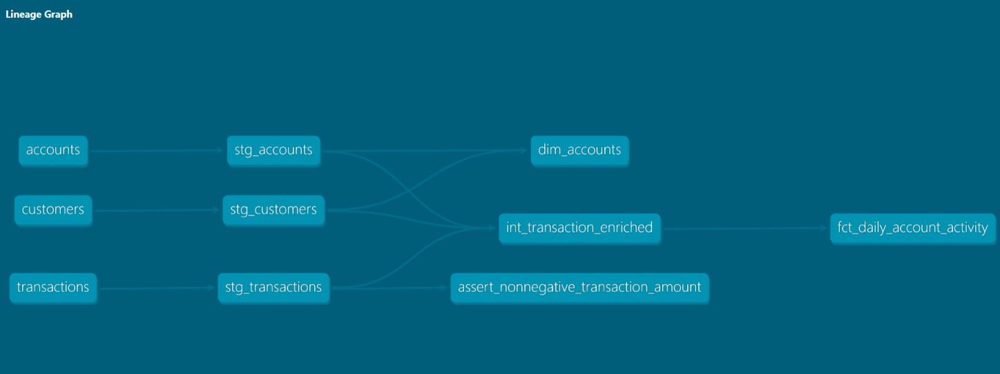

# Week 9 | Standalone Banking Analytics with dbt

## 1. Project Overview

This project builds a standalone banking analytics pipeline using **dbt Core** and **DuckDB**.

It transforms synthetic banking data into analytics-ready models using dbt's staging, intermediate, and mart layers. The project also includes data-quality tests, model documentation, and lineage visualization.

The original source CSV files are preserved without modification.

## 2. Technologies Used

- Python
- dbt Core
- dbt-duckdb
- DuckDB
- SQL
- Git and GitHub

## 3. Project Structure

```text
week_09_dbt_project/
│
├── seeds/
│   ├── customers.csv
│   ├── accounts.csv
│   └── transactions.csv
│
├── models/
│   ├── staging/
│   │   ├── stg_customers.sql
│   │   ├── stg_accounts.sql
│   │   ├── stg_transactions.sql
│   │   └── sources_and_models.yml
│   │
│   ├── intermediate/
│   │   └── int_transaction_enriched.sql
│   │
│   └── marts/
│       ├── dim_accounts.sql
│       ├── fct_daily_account_activity.sql
│       └── marts.yml
│
├── tests/
│   └── assert_nonnegative_transaction_amount.sql
│
├── docs/
│   └── dbt_lineage.png
│
├── dbt_project.yml
├── profiles.yml.example
├── requirements.txt
└── README.md
```

## 4. Project Setup

### Prerequisites

- Python 3.11 or 3.12
- pip
- Git (optional)

### Clone the repository

```bash
git clone https://github.com/parth-pawar/banking_data_pipeline.git
cd banking_data_pipeline/week_09_dbt_project
```

### Create and activate a virtual environment

Windows PowerShell:

```powershell
python -m venv .venv
.\.venv\Scripts\Activate.ps1
```

### Install dependencies

```bash
pip install -r requirements.txt
```

### Configure the dbt profile

Copy the example profile:

```powershell
Copy-Item profiles.yml.example profiles.yml
```

The profile uses DuckDB and stores the local database in `dev.duckdb`.

### Verify the connection

```bash
dbt debug --profiles-dir .
```

## 5. Running the Project

Run the following commands from the `week_09_dbt_project` directory.

### Load source CSV files

```bash
dbt seed --profiles-dir .
```

### Build models and run tests

```bash
dbt build --profiles-dir .
```

### Generate documentation

```bash
dbt docs generate --profiles-dir .
```

### Serve documentation locally

```bash
dbt docs serve --profiles-dir . --port 8080
```

Open `http://localhost:8080` in a browser to explore model documentation and lineage.

## 6. Data Transformation

The project follows a layered dbt structure.

### Staging Layer

- `stg_customers`: Casts customer fields into appropriate data types.
- `stg_accounts`: Casts account fields, including the account opening date.
- `stg_transactions`: Casts transaction fields, including dates and decimal amounts.

### Intermediate Layer

- `int_transaction_enriched`: Joins transactions with account and customer details.
- Calculates `signed_amount`:
  - DEPOSIT: positive amount.
  - PURCHASE: negative amount.
  - WITHDRAWAL: negative amount.

### Mart Layer

- `dim_accounts`: Provides one row per account with associated customer information.
- `fct_daily_account_activity`: Aggregates daily account activity by transaction date and account.

The fact model includes:

- `transaction_count`
- `total_deposits`
- `total_outflows`
- `net_amount`

## 7. Data Quality Tests

The project includes:

- Unique and not-null checks for customer, account, and transaction identifiers.
- Relationship checks between accounts and customers.
- Relationship checks between transactions and accounts.
- Accepted values for transaction types: `DEPOSIT`, `PURCHASE`, and `WITHDRAWAL`.
- A custom SQL test to detect negative raw transaction amounts.
- Mart-level not-null and uniqueness checks.

## 8. Build and Test Results

The complete `dbt build` command completed successfully.

| Component | Result |
|---|---:|
| Seeds loaded | 3 |
| Models created | 6 |
| Data tests passed | 17 |
| Total build operations passed | 26 |
| Warnings | 0 |
| Errors | 0 |

### Aggregate Verification

The daily account activity model produced these totals:

| Metric | Amount (USD) |
|---|---:|
| Total deposits | 3,760.00 |
| Total outflows | 1,250.00 |
| Net amount | 2,510.00 |

Net amount = Total deposits − Total outflows.

## 9.  Model Dependencies and Data Lineage

The dbt project follows a layered transformation structure.

1. **Seeds:** The three CSV files (`customers`, `accounts`, and `transactions`) are loaded into DuckDB using `dbt seed`.
2. **Staging:** Each source table is cleaned and cast into consistent data types through its corresponding staging model.
3. **Intermediate:** `int_transaction_enriched` joins transactions with account and customer information and calculates signed transaction amounts.
4. **Marts:** `dim_accounts` provides account-level customer information, while `fct_daily_account_activity` aggregates transactions by date and account.

The models use dbt's `ref()` function to declare dependencies. dbt uses these references to build the correct execution order and generate the lineage graph.

The dbt lineage graph illustrates the dependencies between source seeds, staging models, the intermediate model, and final marts.



The intermediate model depends on all three staging models. The account dimension depends on customer and account staging models, while the daily activity fact depends on the enriched transaction model.

## 10. Business Rules and Assumptions

- Each account belongs to one customer.
- Each transaction belongs to one account.
- Transaction amounts are stored as positive magnitudes in the source data.
- Deposits are treated as inflows.
- Purchases and withdrawals are treated as outflows.
- All transaction amounts are in USD.
- Closed accounts are retained in the account dimension.
- Source CSV files are not modified.
- The daily activity fact table contains one row per transaction date and account with activity.

## 11. Limitations

- The project uses synthetic CSV data.
- DuckDB is used as a local analytical database.
- The pipeline is executed manually and does not include production scheduling.
- No cloud data warehouse or production orchestration is implemented.

## 12. Conclusion

This project demonstrates how dbt can organize SQL transformations into reusable layers, manage model dependencies, validate data quality, and generate documentation and lineage for a banking analytics workflow.

### CI Validation


GitHub Actions is configured to automatically validate the project on pull requests that modify the Week 9 project or its workflow.

**Workflow:** `Week 9 dbt CI`

**CI Process:**
1. Checks out the repository.
2. Sets up Python 3.11.
3. Installs dependencies from `requirements.txt`.
4. Configures the dbt profile using `profiles.yml.example`.
5. Runs `dbt build`.

**Latest CI Result:**
- Pull Request: [#1 – Week 9: Standalone Banking Analytics with dbt](https://github.com/parth-pawar/banking_data_pipeline/pull/1)
- Workflow Run: [Week 9 dbt CI – Run #1](https://github.com/parth-pawar/banking_data_pipeline/actions/runs/41869399065)
- Status: **Passed**
- Execution time: 35 seconds

The CI build completed successfully, confirming that the project can be built in a clean GitHub Actions environment.